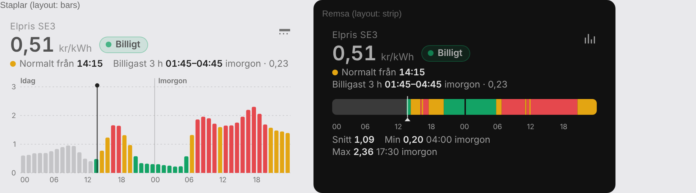

# Nordpool 3.0 – elpris med nivåerna Billigt / Normalt / Dyrt



Version 3.0 består av två delar:

| Fil | Vad |
|---|---|
| `nordpool_templates.yaml` | `sensor.elpris` (aktuellt pris + alla priser idag/imorgon + nivågränser) och `sensor.elpris_niva` (`CHEAP` / `NORMAL` / `EXPENSIVE`) |
| `nordpool-level-card.js` | Eget Lovelace-kort `custom:nordpool-level-card`. Det har inga beroenden och ritar staplar eller en tidslinje-remsa |

## Så räknas nivåerna

Nivåerna räknas på **idag + imorgon** (15-minuterspriser). Igår påverkar dem inte. Innan morgondagens priser har publicerats (~13:00) räknas de bara på idag.

1. Percentil 35 och 70, vilket ger ungefär 35 % billigt, 35 % normalt och 30 % dyrt.
2. **Golv** (`floor_price`, standard 0,30 kr): under golvet är det alltid Billigt.
3. **Tak** (`ceiling_price`, standard 2,00 kr): över taket är det alltid Dyrt.

```
cheap_max  = min(max(p35, golv), tak)
normal_max = max(min(p70, tak), cheap_max)
```

Därmed blir en jämnt dyr dag inte delvis grön, och en jämnt billig dag inte delvis röd.

Kortet färgar staplarna med samma `cheap_max` och `normal_max` som `sensor.elpris_niva` använder, så kortet och automationerna är alltid överens.

## Installation

### 1. Templates

1. Kopiera `nordpool_templates.yaml` till `/config/` och lägg till den som package i `configuration.yaml`:
   ```yaml
   homeassistant:
     packages:
       elpris: !include nordpool_templates.yaml
   ```
2. Ändra inställningarna i det första `variables`-steget i filen:
   - `config_entry`: Nord Pool-integrationens id. Du hittar det under *Utvecklarverktyg → Åtgärder → `nordpool.get_prices_for_date`*: välj integrationen, växla till YAML-läge och kopiera värdet.
   - `area` / `currency`: t.ex. `SE3` / `SEK`
   - `floor_price` / `ceiling_price`: golv och tak i kr/kWh
3. Starta om Home Assistant (eller ladda om template-entiteter).

Sensorn uppdateras var 15:e minut och vid omstart.

### 2. Kortet

1. Kopiera `nordpool-level-card.js` till `/config/www/`.
2. *Inställningar → Kontrollpaneler → ⋮ → Resurser → Lägg till resurs*
   - URL: `/local/nordpool-level-card.js`
   - Typ: *JavaScript-modul*
3. Ladda om webbläsaren (töm gärna cachen) och lägg till kortet.

**Visuellt:** *Redigera kontrollpanel → + Lägg till kort*, sök på **Nordpool prisnivå**. Kortet väljer automatiskt `sensor.elpris`. Allt kan sedan ställas in i formuläret med live-förhandsvisning bredvid: sensor, rubrik, vy, upplösning, enhet, decimaler, billigaste fönster, diagramhöjd, gränslinjer och färger (under *Färger*). Editorn sparar bara värden som skiljer sig från standard, så YAML:en hålls kort.

**Eller med YAML:**

```yaml
type: custom:nordpool-level-card
entity: sensor.elpris
title: Elpris SE3
```

### Alla inställningar

| Nyckel | Standard | Beskrivning |
|---|---|---|
| `entity` | `sensor.elpris` | Sensorn från templatefilen |
| `title` | – | Liten rubrik ovanför priset |
| `layout` | `bars` | `bars` (staplar) eller `strip` (tidslinje-remsa). Ikonen uppe till höger växlar, och valet sparas i webbläsaren |
| `resolution` | `hour` | `hour` (timsnitt, där tooltipen visar de fyra kvartarna) eller `quarter` (alla 15-minuterspriser) |
| `unit` | `kr` | `kr` eller `öre` |
| `decimals` | 2 (kr) / 0 (öre) | Antal decimaler |
| `cheap_window_hours` | `3` | Längd på "Billigast X h"-fönstret i sammanfattningen. `0` döljer det |
| `show_thresholds` | `false` | Streckade linjer för `cheap_max` och `normal_max` |
| `height` | `120` | Staplarnas höjd i px |
| `colors` | grön / bärnsten / röd | `{cheap: '#13a365', normal: '#e3a512', expensive: '#e5484d'}` |

Kortet visar:
- aktuellt kvartspris och nivåchip
- nästa nivåbyte ("Normalt från 14:15")
- det billigaste sammanhängande fönstret framåt
- staplar eller remsa där passerad tid är grå och nu-tiden markeras
- en tooltip vid hover eller tryck

## Automationer

`sensor.elpris_niva` har samma värden som tidigare (`CHEAP` / `NORMAL` / `EXPENSIVE`), så `Prisnivakontroll_blueprint.yaml` fungerar direkt. Peka bara blueprinten mot `sensor.elpris_niva`.

Attributet `next_change` anger när nivån byter nästa gång, t.ex. `{'level': 'EXPENSIVE', 'start': '2026-10-11T16:00:00+02:00'}`.
